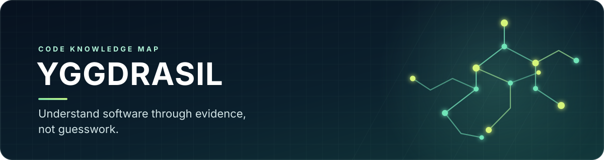
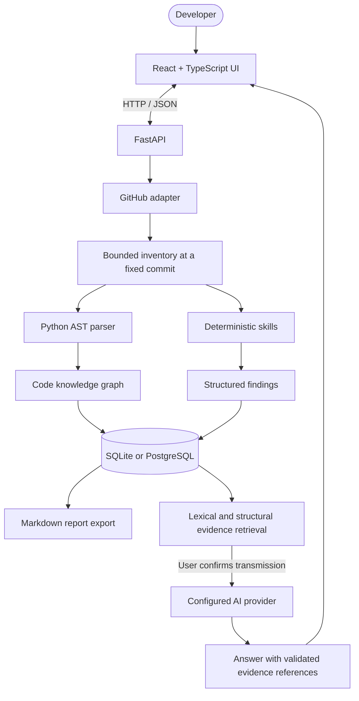

<div align="center">



# Yggdrasil

**Static repository analysis and code knowledge mapping, with an interactive graph and evidence-backed AI-assisted exploration.**


[Overview](#-overview) · [Features](#-features) · [Architecture](#-architecture) · [Getting started](#-getting-started) · [Tests](#-tests-and-validation) · [API](#-api) · [Roadmap](#-roadmap)

🌐 [Português (Brasil)](README.md) · English

</div>

---

## 📸 Demo

Yggdrasil has an interactive React interface for exploring repository analyses, graph nodes, findings, and source evidence. A real screenshot or recording has not yet been committed; this section will be updated when a demonstration captured from a running build is available.

<!-- TODO: Capture a real run and add it to docs/assets/demo.gif.
<p align="center"></p>
-->

## 📖 Overview

Understanding an unfamiliar codebase means moving between files, definitions, imports, tests, configuration, and documentation. A README rarely explains every relationship, and a static-analysis finding is useful only when its evidence can be checked.

**Yggdrasil** turns a public GitHub repository into a commit-pinned inventory, a navigable graph, structured findings, and Markdown reports. It extracts supported Python structure without executing the analyzed project, then lets developers explore components and ask evidence-grounded questions through an optional AI provider.

The graph is central to the experience: users can navigate the structure and relationships between components, while AI helps investigate evidence related to a question. Yggdrasil is an evolving local-first MVP—not a promise of complete code comprehension or vulnerability-free software.

## ✨ Features

- 🌳 **Commit-pinned analysis** — resolves a Git reference to a commit SHA so results can be traced to a specific repository revision.
- 🗂️ **Bounded repository inventory** — records discovered files and directories, applied limits, and reasons for exclusions or partial coverage.
- 🐍 **Static Python parsing** — extracts supported modules, classes, functions, methods, imports, test-file indicators, and selected endpoint patterns without importing or executing target code.
- 🕸️ **Interactive knowledge graph** — explores files and symbols, with source locations and provenance for deterministic versus inferred relationships.
- 🔎 **Question-guided exploration** — retrieves definitions, related tests and examples, relevant documentation, and graph relationships before querying AI.
- 🧭 **Visual analysis trace** — surfaces observable analysis events and helps relate discovered components to evidence; it does not represent or expose private model reasoning.
- 🛡️ **Initial AppSec checks** — identifies patterns that may indicate exposed secrets, redacts recognized patterns before source content is persisted, and creates findings for human review.
- 🧪 **Test-file inventory** — recognizes simple Python test-file conventions; it does not execute tests or measure coverage.
- 📍 **Verifiable citations** — validates references against retrieved evidence and may return an inconclusive result when support is insufficient.
- 📡 **Live analysis updates** — persisted events and Server-Sent Events (SSE) communicate progress and allow clients to resume from a known event position.
- 📝 **Markdown reports** — generates reports from persisted data rather than an unverified free-form conversation.
- 🧭 **Human review of findings** — records confirmation, false positives, accepted risk, non-reproducibility, or a fix in another revision.
- ⚙️ **SQLite by default** — starts without a database server; PostgreSQL is also supported.
- 📏 **Offline RAG retrieval evaluation** — includes a labelled corpus and Hit@k, Recall@k, MRR, and intent metrics, without provider calls during retrieval evaluation.
- 🖥️ **Experimental Windows desktop app** — includes a PyInstaller-packaged launcher, local AI configuration, and SQLite persistence. The local build from 2026-10-27 at 23:40 was selected after manual testing: it starts quickly, lets the user configure an API, and use the chatbot. Some UI/UX bugs remain, and clean-Windows acceptance is pending; the official release has not been published yet.

## 🧰 Tech stack

<p align="center">
  
</p>

| Layer | Technology | Role |
|---|---|---|
| Web UI | React 19, TypeScript, Vite | Interactive single-page application |
| Graph canvas | `@xyflow/react` | Graph navigation, selection, zoom, and pan |
| API | Python 3.11+, FastAPI, Pydantic | HTTP API, validation, and analysis orchestration |
| Static analysis | Python `ast` | Extracts supported Python syntax without executing target code |
| Persistence | SQLAlchemy, Alembic, SQLite / PostgreSQL | Stores analysis snapshots, graph data, events, findings, and exports |
| Progress | Server-Sent Events | Streams analysis events to the browser |
| AI (optional) | Configurable OpenAI-compatible interface, including the Gemini API path | Evidence-grounded question answering; disabled by default |
| Windows desktop | PyInstaller | Experimental packaging for the local launcher |
| Optional local stack | Docker Compose | PostgreSQL, API, and web UI |

## 🧩 Architecture



### Evidence model

Yggdrasil distinguishes **deterministically extracted facts** from **inferred relationships**. Relationships inferred from matching names are not presented as confirmed runtime behavior. AI answers are tied to retrieved references, but their semantic conclusions still require human review.

## 🚀 Getting started

### Prerequisites

- **Python 3.11+** (the Windows helper prefers Python 3.13 when available).
- **Node.js 22.12+ and npm** for the web UI.
- **Git** to clone the repository.
- **Docker Desktop** only if you want to use Docker Compose.

> [!IMPORTANT]
> The MVP has no user authentication for network use. Run it locally and keep ports bound to localhost. Do not expose the API or UI to a shared network or the public internet without authentication, authorization, request limits, and a security review.

### Windows — one-command development start

```powershell
git clone https://github.com/GabrielJalmeida/yggdrasil.git
cd yggdrasil
powershell -NoProfile -ExecutionPolicy Bypass -File ".\scripts\start-dev.ps1"
```

The script creates `.env` from `.env.example` when needed, creates a Python virtual environment, installs API development dependencies, applies database migrations, opens the API in a separate PowerShell window, and starts Vite.

Open:

- **Web UI:** <http://localhost:5173>
- **FastAPI / OpenAPI docs:** <http://127.0.0.1:8000/docs>
- **Health check:** <http://127.0.0.1:8000/api/v1/health>

The default database is local SQLite at `services/api/data/yggdrasil.db`. AI questions remain disabled until a provider is configured.

### Docker Compose

With Docker Desktop running:

```powershell
docker compose up --build
```

Open <http://localhost:5173>. Compose starts PostgreSQL, the API, and the web UI; exposed ports are bound to `127.0.0.1`. Compose database credentials are for development only and must not be reused in real environments.

### Manual development setup

<details>
<summary><strong>Start the API and web UI in separate terminals</strong></summary>

**Terminal 1 — API (from the repository root):**

```powershell
Copy-Item .env.example .env  # only if .env does not exist
cd services/api
py -3.13 -m venv .venv
.\.venv\Scripts\Activate.ps1
python -m pip install --upgrade pip
python -m pip install -e ".[dev]"
python -m alembic upgrade head
python -m uvicorn app.main:app --reload --host 127.0.0.1 --port 8000
```

**Terminal 2 — web UI:**

```powershell
cd apps/web
npm install
npm run dev
```

Linux/macOS helper scripts are available at `scripts/start-api.sh` and `scripts/start-web.sh`.

</details>

### Windows desktop package (experimental)

The build script prepares the frontend, runs local checks, packages the launcher with PyInstaller, and creates a ZIP in Downloads:

```powershell
powershell -NoProfile -ExecutionPolicy Bypass -File ".\desktop\build-windows.ps1"
```

To test an extracted package, run `desktop\test-windows-package.ps1` and pass the package directory through `-PackageDirectory`. The automated local smoke test checked startup, UI, local session token, health check, SQLite creation, and persistence across a second launch.

**Manually selected candidate:** the executable built on 2026-10-27 at 23:40 was launched on the development Windows machine; configuring the API and using the chatbot were exercised and worked better than in the earlier build. Some UI/UX bugs still need to be documented and reviewed. The package has not been accepted on a clean Windows machine without Python, Node.js, and Docker.

The planned distribution method is a ZIP attached to a **GitHub Release**, separate from the source repository—not a binary committed to Git. Before publishing, confirm the exact ZIP path/name for the selected build, calculate its SHA-256, and complete clean-machine acceptance. The locally tested candidate is not yet an official published release.

## 🔧 Configuration

Copy `.env.example` to `.env`. The application runs without an AI key; configure a provider only if you want to ask questions about an analyzed repository.

<details>
<summary><strong>Environment variables</strong></summary>

| Variable | Default | Purpose |
|---|---|---|
| `DATABASE_URL` | `sqlite:///./data/yggdrasil.db` | SQLAlchemy database URL; supports SQLite and PostgreSQL. |
| `GITHUB_TOKEN` | Empty | Optional token to increase GitHub API rate limits for public repositories. |
| `FRONTEND_ORIGINS` | `http://localhost:5173,http://127.0.0.1:5173` | Origins allowed by API CORS. |
| `MAX_ARCHIVE_BYTES` | `20971520` | Maximum compressed archive size (20 MiB). |
| `MAX_FILES` | `1000` | Maximum inventory entries/files. |
| `MAX_TREE_DIRECTORIES` | `2000` | Maximum subdirectory queries when rebuilding a truncated Git tree. |
| `MAX_FILE_BYTES` | `262144` | Maximum size for an individual text file (256 KiB). |
| `MAX_TOTAL_TEXT_BYTES` | `8388608` | Aggregate text-content budget (8 MiB). |
| `MAX_TOTAL_UNPACKED_BYTES` | `52428800` | Maximum declared uncompressed data (50 MiB). |
| `AI_PROVIDER` | `disabled` | Set to `openai-compatible` to enable the configured AI adapter. |
| `AI_API_KEY` | Empty | Provider key. Required for hosted services; may be omitted only for recognized local endpoints. |
| `AI_BASE_URL` | `https://api.openai.com/v1` | Configured provider base URL. The Gemini API path uses `https://generativelanguage.googleapis.com`. |
| `AI_MODEL` | Empty | Model identifier available to your provider/account. |
| `AI_TIMEOUT_SECONDS` | `90` | AI request timeout; the Gemini path has a 90-second minimum. |
| `AI_REASONING_EFFORT` | `low` | Reasoning level passed to the Gemini path. |
| `AI_MAX_CONTEXT_CHARS` | `14000` | Approximate character budget for retrieved context. |
| `AI_MAX_EVIDENCE_ITEMS` | `8` | Maximum retrieved evidence items per question. |

</details>

### Enable AI questions

Add provider settings to `.env` and restart the API. This example was used in the local validation environment:

```dotenv
AI_PROVIDER=openai-compatible
AI_API_KEY=your-google-ai-studio-key
AI_BASE_URL=https://generativelanguage.googleapis.com
AI_MODEL=gemini-3.6-flash
AI_TIMEOUT_SECONDS=90
AI_REASONING_EFFORT=medium
```

Use a model ID available to your account and region. The example above was used in the local environment on 2026-10-27 and does not guarantee universal availability. Never commit `.env`, API keys, or real credentials. The browser never receives the key. Before sending a question, the UI explains that the question and selected **redacted** evidence snippets will be transmitted to the configured provider after confirmation; the full repository is not sent as a single prompt.

## 💡 Typical workflow

1. Paste a public repository URL such as `https://github.com/owner/project` into the UI and choose a Git reference (for example, `main`).
2. Start the analysis. Yggdrasil resolves the reference to a commit and displays inventory coverage, supported Python symbols, graph relations, warnings, and findings.
3. Search or filter the graph; select a node to inspect its location and available source evidence.
4. Review generated findings. Treat them as candidates until you inspect their evidence and impact.
5. When AI is configured, ask a question about the analyzed snapshot and open the cited references. Check the evidence before relying on the conclusion.
6. Export the analysis to Markdown.

## 📡 API

The API prefix is `/api/v1`. Interactive OpenAPI documentation is available at <http://127.0.0.1:8000/docs> while the local API is running.

<details>
<summary><strong>Available endpoints</strong></summary>

| Method | Endpoint | Purpose |
|---|---|---|
| `GET` | `/api/v1/health` | Health and database readiness check. |
| `GET` | `/api/v1/skills` | Lists enabled skills and their limitations. |
| `POST` | `/api/v1/analyses` | Starts an analysis (`202 Accepted`). |
| `GET` | `/api/v1/analyses` | Lists recent analyses. |
| `GET` | `/api/v1/analyses/{analysis_id}` | Reads analysis status, commit, counts, coverage, and warnings. |
| `GET` | `/api/v1/analyses/{analysis_id}/events` | Streams and replays persisted events as SSE. |
| `GET` | `/api/v1/analyses/{analysis_id}/graph` | Queries nodes and edges with server-side search and filters. |
| `GET` | `/api/v1/analyses/{analysis_id}/nodes/{node_id}` | Loads node details and available source evidence. |
| `GET` | `/api/v1/analyses/{analysis_id}/findings` | Lists findings; supports severity, skill, and status filters. |
| `PATCH` | `/api/v1/analyses/{analysis_id}/findings/{finding_id}/status` | Stores a human review decision. |
| `POST` | `/api/v1/analyses/{analysis_id}/questions` | Asks an evidence-grounded question about a completed analysis. |
| `GET` | `/api/v1/analyses/{analysis_id}/export/markdown` | Downloads the report directly. |
| `POST` | `/api/v1/analyses/{analysis_id}/exports/markdown` | Creates a persisted Markdown export. |
| `GET` | `/api/v1/exports/{export_id}` | Downloads a persisted export. |

</details>

## 🧪 Tests and validation

### Clean-clone validation — 2026-10-28

Branch `test/env-file-detection`, commit `3d07627`, was cloned into a separate Windows directory and tested without reusing the Python environment from the development repository. This validates that commit; it does not mean the commit has been merged into `main`, that CI passed, or that the desktop package has passed clean-machine acceptance.

- **Backend:** the full `python -m pytest -q` suite passed with no failures in the clone. Pytest reported a `StarletteDeprecationWarning` about using `httpx` with `starlette.testclient`; it did not block the tests.
- **Frontend installation:** `npm.cmd ci` installed dependencies and npm reported zero vulnerabilities in its audit. Warnings noted a deprecated ESLint version and an `esbuild` install script blocked by the local npm script policy; the checks below still passed.
- **ESLint:** `npm.cmd run lint` passed.
- **Production build:** `npm.cmd run build` passed, including `tsc -b` and Vite.
- **Graph layout:** `npm.cmd run test:layout` passed: 420 nodes, no overlaps; overview contained 180 nodes and filtered module views contained 20.
- **Offline skills benchmark:** 6/6 cases passed, `quality_score=1.0`, `provider_calls=0`. This validates the deterministic contracts represented in the corpus, not the absolute security of a target repository.
- **Real RAG retrieval evaluation:** on `kinegratii/borax` snapshot `01cbbbf7ce33ee22d23c462c525d07e1320e67a7`, 6 of 7 cases were scored; `intent_accuracy=1.0`, `MRR=0.7833`, `Hit@1=0.6667`, `Hit@3=0.8333`, `Hit@5=1.0`, `Recall@1=0.5`, `Recall@3=0.75`, and `Recall@5=1.0`. Compared with the baseline on the same snapshot, MRR improved from `0.7208` to `0.7833`, Hit@3 from `0.6667` to `0.8333`, Hit@5 from `0.8333` to `1.0`, and Recall@5 from `0.75` to `1.0`. The case asking whether static analysis proves the absence of vulnerabilities is not scored for retrieval, because that requires semantic evaluation of a generated answer.
- **Answer-quality corpus:** `python scripts/evaluate_answers.py --latest` passed in simulation mode, validating the corpus and expected snapshot and reporting four questions that would be run. No question was sent to AI; this is not a semantic evaluation of model-generated answers.
- **Desktop:** the local smoke test checked startup, UI, local session token, health check, and SQLite persistence. The executable built on 2026-10-27 at 23:40 was selected by the user after launching it, configuring the API, and exercising the chatbot on the development machine. UI/UX bugs remain; clean-Windows acceptance and identification of the exact ZIP/SHA-256 for the release are pending.

These results apply to the stated commit/snapshot. They do not mean CI passed or that the desktop app was accepted on a clean machine.

To repeat the code validation from a separate clone while the test branch remains available:

```powershell
git clone --branch test/env-file-detection --single-branch https://github.com/GabrielJalmeida/yggdrasil.git ..\yggdrasil-clean-check
```

Then enter the cloned directory and follow the commands below. The recorded test clone used commit `3d07627`.

### Run backend tests

From the repository root, in PowerShell:

```powershell
cd services/api
python -m venv .venv
.\.venv\Scripts\python.exe -m pip install -e ".[dev]"
.\.venv\Scripts\python.exe -m alembic upgrade head
.\.venv\Scripts\python.exe -m pytest -q
.\.venv\Scripts\python.exe scripts/evaluate_skills.py
```

The virtual environment isolates dependencies. These commands invoke its Python executable directly, without relying on environment activation.

### Run frontend checks

```powershell
cd apps/web
npm ci
npm run lint
npm run build
npm run test:layout
```

If PowerShell blocks `npm.ps1` with an execution-policy error, use the `npm.cmd` wrappers (for example, `npm.cmd ci` and `npm.cmd run build`) instead of weakening the Windows execution policy.

### Offline RAG retrieval evaluation

The evaluation requires a completed analysis for the repository declared by the corpus, persisted in the **same database** used by the script. Start the API/web app, analyze `https://github.com/kinegratii/borax` at reference `master`, and wait for completion. Then, from `services/api`, run:

```powershell
python scripts/evaluate_rag.py --latest --cases evaluation/corpora/borax.json
```

`--latest` selects the most recent completed analysis for that repository, not the latest analysis of any repository. To save a report:

```powershell
python scripts/evaluate_rag.py --latest --cases evaluation/corpora/borax.json --output .\data\rag-evaluation-borax.json
```

The report records the analyzed SHA, metrics, and invalid/missing annotations. These metrics measure retrieval, not the semantic correctness of answers. See [`docs/RAG-EVALUATION.md`](docs/RAG-EVALUATION.md).

### Validate the answer-quality corpus without AI

```powershell
python scripts/evaluate_answers.py --latest
```

Without `--run-provider`, this command is only a simulation: it validates the corpus and checks that the persisted analysis matches the expected snapshot, but it does not generate or judge answers. Adding `--run-provider` sends real questions to the configured model and may consume quota or incur cost; use it only intentionally.

## 🛡️ Security, privacy, and boundaries

- **Read-only analysis:** target code is not imported, executed, built, installed, or tested by Yggdrasil.
- **GitHub origin restrictions:** repository URLs are validated and network requests use fixed GitHub hosts; redirects are rejected.
- **Resource limits:** archive size, file count, individual file size, aggregate content, and tree traversal have configurable bounds.
- **Secret redaction:** supported credential patterns are redacted before source text is persisted. Pattern-based redaction can miss unknown or encoded secrets and is not a guarantee of anonymization.
- **Untrusted repository content:** README text, comments, strings, and source files are treated as untrusted data; the model receives no shell, filesystem, or write-capable tools.
- **AI privacy:** when AI is enabled, the question and selected redacted snippets are sent to the configured provider after user confirmation. Do not submit code unless that transfer is authorized.
- **No network authentication:** this MVP is designed for local use; keep services on localhost.
- **Static-analysis limits:** findings require human review. The absence of a finding does not prove a repository is secure.

See [`docs/SECURITY.md`](docs/SECURITY.md) for the threat model and residual risks.

## 🗂️ Repository structure

```text
yggdrasil/
├── apps/web/                  # React + TypeScript UI and graph canvas
├── desktop/                   # Launcher, local secure storage, experimental Windows build
├── services/api/
│   ├── app/api/               # FastAPI routes
│   ├── app/application/       # Analysis, question, and evaluation orchestration
│   ├── app/domain/            # Graph, findings, reports, and skills
│   ├── app/infrastructure/    # GitHub adapter and AI provider
│   ├── evaluation/corpora/    # Versioned evaluation corpora
│   └── tests/                 # Backend unit and integration tests
├── skills/                    # Versioned skill contracts and manifests
├── docs/                      # Master plan, security, progress, and evaluations
│   └── assets/banner.svg      # README banner
├── scripts/                   # Windows/Linux development helpers
├── .env.example               # Non-secret configuration template
└── docker-compose.yml         # Optional local PostgreSQL stack
```

## 🧭 Roadmap

- [x] Public GitHub repository ingestion pinned to a commit.
- [x] Static Python parsing and persisted knowledge graph.
- [x] Initial deterministic skills and structured human-reviewed findings.
- [x] Evidence-grounded AI questions with citation validation.
- [x] Progress events and Markdown report export.
- [x] SQLite default with PostgreSQL support.
- [x] Initial offline retrieval-evaluation harness and versioned corpus.
- [x] Experimental Windows desktop package, local smoke test, and manual API/chatbot configuration flow exercised on the selected build.
- [x] Validate the backend suite, frontend lint/build, graph layout, offline skills benchmark, and RAG evaluation in a clean clone of commit `3d07627`.
- [ ] Fix/document remaining desktop UI/UX bugs.
- [ ] Test the selected ZIP on clean Windows, identify the exact artifact, calculate SHA-256, and publish a GitHub Release separate from source code.
- [ ] Run real AI answer evaluations with human review; `evaluate_answers.py --latest` simulation does not measure semantic correctness.
- [ ] Validate clean installation, build, and frontend lint in CI.
- [ ] Improve graph navigation and large-result pagination based on observed use.
- [ ] Consider a second language and semantic retrieval only if evaluation demonstrates value.
- [ ] Explore snapshot comparison and incremental re-analysis.

Read the [Master Engineering Plan](docs/MASTER-PLAN.md) (pt-BR) for product direction and [`docs/PROGRESS.md`](docs/PROGRESS.md) for verified implementation state and remaining limitations.

## 🤝 Contributing

Issues and focused pull requests are welcome. Before proposing features, read the current limits and security model. Prefer small, testable changes that preserve read-only analysis of third-party repositories.

1. Fork the repository and create a branch from `main`.
2. Make a focused change and add or update tests.
3. Run the relevant backend or frontend checks.
4. Describe behavior, test evidence, and remaining limitations in the pull request.

## 📜 License

Yggdrasil is distributed under the [MIT License](LICENSE).

## 👤 Author

Created by **[GabrielJalmeida](https://github.com/GabrielJalmeida)**.

---

<div align="center">

**Map before guessing. Evidence before conclusions.**

If Yggdrasil is useful to you, consider giving the repository a ⭐.

</div>
