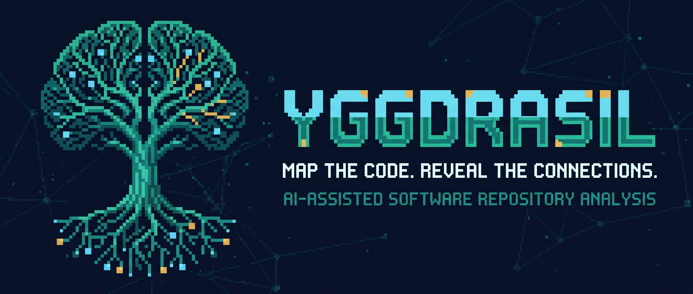

<div align="center">



# Yggdrasil

**Análise estática e mapa de conhecimento de repositórios, com grafo interativo e investigação assistida por IA baseada em evidências.**


[Visão geral](#-visão-geral) · [Funcionalidades](#-funcionalidades) · [Arquitetura](#-arquitetura) · [Começando](#-começando) · [Testes](#-testes-e-validação) · [API](#-api) · [Roadmap](#-roadmap)

🌐 Português (Brasil) · [English](README-EN.md)

</div>

---

## 📸 Demonstração

O Yggdrasil possui uma interface React interativa para explorar análises de repositórios, nós do grafo, achados e evidências de código. Uma captura de tela ou gravação real ainda não foi versionada; esta seção será atualizada quando uma demonstração capturada da aplicação em execução estiver disponível.

<!-- TODO: Capturar uma execução real e adicionar em docs/assets/demo.gif.
<p align="center"></p>
-->

## 📖 Visão geral

Entender um código desconhecido exige navegar entre arquivos, definições, imports, testes, configurações e documentação. Um README raramente explica todas as relações, e um achado de análise estática só é útil quando suas evidências podem ser verificadas.

O **Yggdrasil** transforma um repositório público do GitHub em um inventário vinculado a um commit específico, um grafo navegável, achados estruturados e relatórios Markdown. Ele extrai a estrutura Python suportada sem executar o projeto analisado e permite explorar componentes e fazer perguntas fundamentadas em evidências por meio de um provedor de IA opcional.

O grafo é uma parte central da experiência: o usuário pode navegar pela estrutura e pelas relações entre componentes, enquanto a IA ajuda a investigar as evidências relacionadas a uma pergunta. O projeto é um MVP local em evolução — não promete compreensão completa do código nem ausência de vulnerabilidades.

## ✨ Funcionalidades

- 🌳 **Análise vinculada a um commit** — resolve a referência Git para um SHA, permitindo rastrear os resultados até uma revisão específica.
- 🗂️ **Inventário com limites** — registra arquivos e diretórios encontrados, limites aplicados e motivos para exclusões ou cobertura parcial.
- 🐍 **Parsing estático de Python** — extrai módulos, classes, funções, métodos, imports, indicadores de arquivos de teste e padrões selecionados de endpoints sem importar ou executar o código-alvo.
- 🕸️ **Grafo de conhecimento interativo** — explora arquivos e símbolos, com localização de origem e indicação da proveniência das relações determinísticas e inferidas.
- 🔎 **Exploração guiada por perguntas** — recupera definições, testes e exemplos relacionados, documentação relevante e relações do grafo antes de consultar a IA.
- 🧭 **Trilha visual da análise** — apresenta eventos observáveis da análise e ajuda a relacionar os componentes encontrados às evidências; não representa nem expõe raciocínio privado do modelo.
- 🛡️ **Verificações AppSec iniciais** — identifica padrões que podem indicar segredos expostos, redige padrões reconhecidos antes de persistir conteúdo e cria achados para revisão humana.
- 🧪 **Inventário de arquivos de teste** — reconhece convenções simples de testes Python; não executa testes nem mede cobertura.
- 📍 **Citações verificáveis** — valida referências contra as evidências recuperadas; pode retornar uma conclusão inconclusiva quando o suporte é insuficiente.
- 📡 **Atualizações de análise** — eventos persistidos e Server-Sent Events (SSE) comunicam progresso e permitem retomar a partir de uma posição conhecida.
- 📝 **Relatórios Markdown** — gera relatórios a partir de dados persistidos, não apenas de uma conversa livre.
- 🧭 **Revisão humana de achados** — registra confirmação, falso positivo, risco aceito, não reproduzibilidade ou correção em outra revisão.
- ⚙️ **SQLite por padrão** — começa sem servidor de banco; PostgreSQL também é suportado.
- 📏 **Avaliação offline da recuperação RAG** — inclui corpus rotulado e métricas Hit@k, Recall@k, MRR e intenção, sem chamadas ao provedor durante a avaliação de recuperação.
- 🖥️ **Aplicativo desktop experimental para Windows** — inclui um inicializador empacotado com PyInstaller, configuração local de IA e persistência SQLite. O build local de 27/10 às 23:40 foi escolhido após teste manual: abre rapidamente, permite configurar a API e usar o chatbot. Ainda há bugs de interface/experiência, e a aceitação em Windows limpo permanece pendente; a release oficial ainda não foi publicada.

## 🧰 Tecnologias

<p align="center">
  
</p>

| Camada | Tecnologia | Papel |
|---|---|---|
| Interface web | React 19, TypeScript, Vite | Aplicação interativa de página única |
| Canvas do grafo | `@xyflow/react` | Navegação, seleção, zoom e pan do grafo |
| API | Python 3.11+, FastAPI, Pydantic | API HTTP, validação e orquestração da análise |
| Análise estática | `ast` da biblioteca padrão Python | Extrai estrutura Python sem executar o código-alvo |
| Persistência | SQLAlchemy, Alembic, SQLite / PostgreSQL | Guarda snapshots, grafo, eventos, achados e exportações |
| Progresso | Server-Sent Events | Envia eventos da análise ao navegador |
| IA (opcional) | Interface configurável compatível com OpenAI, incluindo o caminho da API Gemini | Perguntas baseadas em evidências; desativada por padrão |
| Desktop Windows | PyInstaller | Empacotamento experimental do launcher local |
| Stack local opcional | Docker Compose | PostgreSQL, API e interface web |

## 🧩 Arquitetura


### Modelo de evidências

O Yggdrasil diferencia **fatos extraídos de forma determinística** de **relações inferidas**. Relações inferidas por nomes coincidentes não são apresentadas como comportamento confirmado em execução. As respostas de IA ficam vinculadas às referências recuperadas, mas suas conclusões semânticas ainda exigem revisão humana.

## 🚀 Começando

### Pré-requisitos

- **Python 3.11+** (o script do Windows dá preferência ao Python 3.13 quando disponível).
- **Node.js 22.12+ e npm** para a interface web.
- **Git** para clonar o repositório.
- **Docker Desktop** apenas se optar pelo Docker Compose.

> [!IMPORTANT]
> O MVP não possui autenticação de usuário para uso em rede. Execute-o localmente e mantenha as portas vinculadas a localhost. Não exponha a API ou a interface a uma rede compartilhada ou à internet sem adicionar autenticação, autorização, limites de requisição e uma revisão de segurança.

### Windows — inicialização de desenvolvimento

```powershell
git clone https://github.com/GabrielJalmeida/yggdrasil.git
cd yggdrasil
powershell -NoProfile -ExecutionPolicy Bypass -File ".\scripts\start-dev.ps1"
```

O script cria `.env` a partir de `.env.example` se necessário, cria um ambiente virtual Python, instala as dependências de desenvolvimento da API, aplica as migrations do banco, abre a API em outra janela do PowerShell e inicia o Vite.

Acesse:

- **Interface web:** <http://localhost:5173>
- **Documentação FastAPI / OpenAPI:** <http://127.0.0.1:8000/docs>
- **Verificação de saúde:** <http://127.0.0.1:8000/api/v1/health>

O banco padrão é SQLite local em `services/api/data/yggdrasil.db`. As perguntas por IA permanecem desativadas até a configuração de um provedor.

### Docker Compose

Com o Docker Desktop aberto:

```powershell
docker compose up --build
```

Abra <http://localhost:5173>. O Compose inicia PostgreSQL, API e interface; as portas são vinculadas a `127.0.0.1`. As credenciais do banco no Compose são exclusivas de desenvolvimento e não devem ser reutilizadas em ambientes reais.

### Configuração manual

<details>
<summary><strong>Inicie a API e a interface em terminais separados</strong></summary>

**Terminal 1 — API (na raiz do repositório):**

```powershell
Copy-Item .env.example .env  # somente se .env ainda não existir
cd services/api
py -3.13 -m venv .venv
.\.venv\Scripts\Activate.ps1
python -m pip install --upgrade pip
python -m pip install -e ".[dev]"
python -m alembic upgrade head
python -m uvicorn app.main:app --reload --host 127.0.0.1 --port 8000
```

**Terminal 2 — interface web:**

```powershell
cd apps/web
npm install
npm run dev
```

Há scripts auxiliares para Linux/macOS em `scripts/start-api.sh` e `scripts/start-web.sh`.

</details>

### Pacote desktop para Windows (experimental)

O script de build prepara o frontend, executa verificações locais, empacota o inicializador com PyInstaller e gera um ZIP em Downloads:

```powershell
powershell -NoProfile -ExecutionPolicy Bypass -File ".\desktop\build-windows.ps1"
```

Para testar um pacote extraído, execute `desktop\test-windows-package.ps1` com o diretório do pacote indicado por `-PackageDirectory`. O smoke test automatizado local verificou inicialização, interface, token de sessão local, health check, criação do SQLite e persistência após uma segunda inicialização.

**Candidato escolhido manualmente:** o executável construído em 27/10/2026 às 23:40 foi aberto no Windows de desenvolvimento; a configuração da API e o uso do chatbot foram exercitados e funcionaram melhor que no build anterior. Ainda há bugs de interface/experiência que precisam ser registrados e avaliados. O pacote ainda não foi aceito em uma máquina Windows limpa sem Python, Node.js e Docker.

A distribuição planejada é um ZIP anexado a uma **GitHub Release**, separado do código-fonte — não um binário commitado no repositório. Antes de publicar a release, confirme o nome/caminho exato do ZIP selecionado, calcule seu SHA-256 e conclua a aceitação em máquina limpa. O candidato testado localmente não deve ser confundido com uma release oficial já publicada.

## 🔧 Configuração

Copie `.env.example` para `.env`. A aplicação funciona sem chave de IA; configure um provedor apenas se quiser perguntar sobre um repositório analisado.

<details>
<summary><strong>Variáveis de ambiente</strong></summary>

| Variável | Padrão | Finalidade |
|---|---|---|
| `DATABASE_URL` | `sqlite:///./data/yggdrasil.db` | URL SQLAlchemy; suporta SQLite e PostgreSQL. |
| `GITHUB_TOKEN` | Vazio | Token opcional para aumentar os limites da API do GitHub em repositórios públicos. |
| `FRONTEND_ORIGINS` | `http://localhost:5173,http://127.0.0.1:5173` | Origens autorizadas no CORS da API. |
| `MAX_ARCHIVE_BYTES` | `20971520` | Tamanho máximo do arquivo compactado (20 MiB). |
| `MAX_FILES` | `1000` | Quantidade máxima de entradas/arquivos no inventário. |
| `MAX_TREE_DIRECTORIES` | `2000` | Máximo de consultas a subdiretórios para reconstruir uma árvore Git truncada. |
| `MAX_FILE_BYTES` | `262144` | Tamanho máximo de um arquivo textual (256 KiB). |
| `MAX_TOTAL_TEXT_BYTES` | `8388608` | Orçamento agregado de conteúdo textual (8 MiB). |
| `MAX_TOTAL_UNPACKED_BYTES` | `52428800` | Máximo de dados declarados após descompactação (50 MiB). |
| `AI_PROVIDER` | `disabled` | Defina `openai-compatible` para ativar o adaptador configurado. |
| `AI_API_KEY` | Vazio | Chave do provedor. Obrigatória para serviços hospedados; só pode ser omitida em endpoints locais reconhecidos. |
| `AI_BASE_URL` | `https://api.openai.com/v1` | URL-base do provedor. Para o caminho da API Gemini, use `https://generativelanguage.googleapis.com`. |
| `AI_MODEL` | Vazio | Identificador de modelo disponível para sua conta/provedor. |
| `AI_TIMEOUT_SECONDS` | `90` | Timeout da chamada de IA; o caminho Gemini exige mínimo de 90 segundos. |
| `AI_REASONING_EFFORT` | `low` | Nível de raciocínio enviado ao caminho Gemini. |
| `AI_MAX_CONTEXT_CHARS` | `14000` | Limite aproximado de caracteres para o contexto recuperado. |
| `AI_MAX_EVIDENCE_ITEMS` | `8` | Máximo de evidências recuperadas por pergunta. |

</details>

### Habilitar perguntas com IA

Adicione as configurações do provedor ao `.env` e reinicie a API. Exemplo usado no ambiente de validação local:

```dotenv
AI_PROVIDER=openai-compatible
AI_API_KEY=sua-chave-do-Google-AI-Studio
AI_BASE_URL=https://generativelanguage.googleapis.com
AI_MODEL=gemini-3.6-flash
AI_TIMEOUT_SECONDS=90
AI_REASONING_EFFORT=medium
```

Use um identificador de modelo disponível para sua conta e região; o exemplo acima foi utilizado no ambiente local em 27/10/2026 e não garante disponibilidade universal. Nunca versione `.env`, chaves de API ou credenciais reais. O navegador não recebe a chave. Antes de enviar uma pergunta, a interface informa que a pergunta e os trechos de evidência selecionados e **redigidos** serão transmitidos ao provedor configurado após confirmação; o repositório inteiro não é enviado como um único prompt.

## 💡 Fluxo de uso

1. Cole na interface a URL de um repositório público, como `https://github.com/owner/project`, e escolha uma referência Git, por exemplo `main`.
2. Inicie a análise. O Yggdrasil resolve a referência para um commit e mostra cobertura do inventário, símbolos Python suportados, relações do grafo, avisos e achados.
3. Busque ou filtre o grafo; selecione um nó para inspecionar a localização e as evidências de origem disponíveis.
4. Revise os achados gerados. Trate-os como candidatos até examinar as evidências e o impacto.
5. Com a IA configurada, faça uma pergunta sobre o snapshot analisado e abra as referências citadas. Confirme as evidências antes de confiar na conclusão.
6. Exporte a análise em Markdown.

## 📡 API

O prefixo da API é `/api/v1`. A documentação OpenAPI interativa fica disponível em <http://127.0.0.1:8000/docs> enquanto a API local estiver em execução.

<details>
<summary><strong>Endpoints disponíveis</strong></summary>

| Método | Endpoint | Finalidade |
|---|---|---|
| `GET` | `/api/v1/health` | Verifica a saúde e a disponibilidade do banco. |
| `GET` | `/api/v1/skills` | Lista as skills habilitadas e suas limitações. |
| `POST` | `/api/v1/analyses` | Inicia uma análise (`202 Accepted`). |
| `GET` | `/api/v1/analyses` | Lista análises recentes. |
| `GET` | `/api/v1/analyses/{analysis_id}` | Consulta estado, commit, contagens, cobertura e avisos. |
| `GET` | `/api/v1/analyses/{analysis_id}/events` | Transmite e reproduz eventos persistidos via SSE. |
| `GET` | `/api/v1/analyses/{analysis_id}/graph` | Consulta nós e arestas com busca e filtros no servidor. |
| `GET` | `/api/v1/analyses/{analysis_id}/nodes/{node_id}` | Carrega detalhes do nó e evidências de origem disponíveis. |
| `GET` | `/api/v1/analyses/{analysis_id}/findings` | Lista achados; aceita filtros de severidade, skill e estado. |
| `PATCH` | `/api/v1/analyses/{analysis_id}/findings/{finding_id}/status` | Registra uma decisão de revisão humana. |
| `POST` | `/api/v1/analyses/{analysis_id}/questions` | Faz uma pergunta fundamentada em evidências sobre uma análise concluída. |
| `GET` | `/api/v1/analyses/{analysis_id}/export/markdown` | Baixa diretamente o relatório. |
| `POST` | `/api/v1/analyses/{analysis_id}/exports/markdown` | Cria uma exportação Markdown persistida. |
| `GET` | `/api/v1/exports/{export_id}` | Baixa uma exportação persistida. |

</details>

## 🧪 Testes e validação

### Validação de clone limpo — 28/10/2026

A branch `test/env-file-detection`, commit `3d07627`, foi clonada em uma pasta separada no Windows e testada sem reaproveitar o ambiente Python do repositório de desenvolvimento. Isso valida o conteúdo daquele commit; não significa que ele já esteja integrado à `main`, que o CI tenha passado ou que o pacote desktop tenha sido aprovado em máquina limpa.

- **Backend:** a suíte completa `python -m pytest -q` passou sem falhas no clone. Foi emitido um `StarletteDeprecationWarning` sobre a integração de `httpx` com `starlette.testclient`; não bloqueou os testes.
- **Frontend:** `npm.cmd ci` instalou as dependências e o npm reportou zero vulnerabilidades na auditoria. Houve avisos de versão descontinuada do ESLint e de script de instalação do `esbuild` bloqueado pela política local do npm; mesmo assim, as verificações seguintes passaram.
- **ESLint:** `npm.cmd run lint` passou.
- **Build de produção:** `npm.cmd run build` passou, incluindo `tsc -b` e Vite.
- **Layout do grafo:** `npm.cmd run test:layout` passou: 420 nós, sem sobreposições; visão geral com 180 nós e módulos filtrados com 20.
- **Benchmark offline de skills:** 6/6 casos aprovados, `quality_score=1.0`, `provider_calls=0`. Isso verifica os contratos determinísticos incluídos no corpus, não a segurança absoluta de um repositório.
- **Avaliação RAG real:** no snapshot `kinegratii/borax` commit `01cbbbf7ce33ee22d23c462c525d07e1320e67a7`, 6 de 7 casos foram pontuados; `intent_accuracy=1.0`, `MRR=0.7833`, `Hit@1=0.6667`, `Hit@3=0.8333`, `Hit@5=1.0`, `Recall@1=0.5`, `Recall@3=0.75` e `Recall@5=1.0`. Comparada à baseline no mesmo snapshot, MRR subiu de `0.7208` para `0.7833`, Hit@3 de `0.6667` para `0.8333`, Hit@5 de `0.8333` para `1.0` e Recall@5 de `0.75` para `1.0`. O caso que pede prova de ausência de vulnerabilidades não conta como recuperação pontuável, porque exige avaliar a resposta semântica.
- **Corpus de qualidade das respostas:** `python scripts/evaluate_answers.py --latest` passou em modo de simulação, validando o corpus e o snapshot esperado e indicando quatro perguntas que seriam executadas. Nenhuma pergunta foi enviada à IA; isso não é uma avaliação semântica gerada pelo modelo.
- **Desktop:** o smoke test local verificou inicialização, UI, token de sessão local, health check e persistência SQLite. O executável de 27/10 às 23:40 foi escolhido pelo usuário após abrir, configurar a API e exercitar o chatbot na máquina de desenvolvimento. Bugs de interface/experiência ainda existem; a aceitação em Windows limpo e a identificação definitiva do ZIP/SHA-256 para release estão pendentes.

Esses resultados são reproduzíveis para o commit/snapshot indicados. Não representam uma aprovação de CI nem um aceite do aplicativo desktop em uma máquina limpa.

Para repetir a validação de código a partir de um clone separado enquanto a branch de teste estiver disponível:

```powershell
git clone --branch test/env-file-detection --single-branch https://github.com/GabrielJalmeida/yggdrasil.git ..\yggdrasil-clean-check
```

Depois, entre na pasta clonada e siga os comandos abaixo. O clone de teste registrado nesta seção era o commit `3d07627`.

### Executar os testes do backend

A partir da raiz do repositório, no PowerShell:

```powershell
cd services/api
python -m venv .venv
.\.venv\Scripts\python.exe -m pip install -e ".[dev]"
.\.venv\Scripts\python.exe -m alembic upgrade head
.\.venv\Scripts\python.exe -m pytest -q
.\.venv\Scripts\python.exe scripts/evaluate_skills.py
```

O ambiente virtual mantém as dependências isoladas. Os comandos usam o executável Python diretamente, sem depender da ativação do ambiente.

### Executar as verificações do frontend

```powershell
cd apps/web
npm ci
npm run lint
npm run build
npm run test:layout
```

Se a política do PowerShell bloquear `npm.ps1` com uma mensagem sobre execução de scripts, use os wrappers `npm.cmd` (por exemplo, `npm.cmd ci` e `npm.cmd run build`) em vez de enfraquecer a política de execução do Windows.

### Avaliação offline da recuperação RAG

A avaliação precisa de uma análise concluída do repositório declarado pelo corpus, persistida no **mesmo banco** usado pelo script. Inicie a API/web, analise `https://github.com/kinegratii/borax` na referência `master` e aguarde a conclusão. Depois, a partir de `services/api`:

```powershell
python scripts/evaluate_rag.py --latest --cases evaluation/corpora/borax.json
```

`--latest` seleciona a análise concluída mais recente daquele repositório, não a última análise de qualquer repositório. Para salvar o relatório:

```powershell
python scripts/evaluate_rag.py --latest --cases evaluation/corpora/borax.json --output .\data\rag-evaluation-borax.json
```

O relatório registra o SHA analisado, métricas e anotações inválidas/ausentes. As métricas medem recuperação, não correção semântica da resposta. Consulte [`docs/RAG-EVALUATION.md`](docs/RAG-EVALUATION.md).

### Validar o corpus de qualidade das respostas sem usar IA

```powershell
python scripts/evaluate_answers.py --latest
```

Sem `--run-provider`, esse comando é apenas uma simulação: verifica se o corpus é válido e se a análise salva corresponde ao snapshot esperado, mas não gera nem julga respostas. Acrescentar `--run-provider` envia perguntas reais ao modelo configurado e pode consumir cota ou gerar custo; use somente quando isso for intencional.

## 🛡️ Segurança, privacidade e limites

- **Análise somente de leitura:** o código-alvo não é importado, executado, compilado, instalado ou testado pelo Yggdrasil.
- **Restrição de origem GitHub:** URLs são validadas e as requisições usam hosts GitHub fixos; redirecionamentos são recusados.
- **Limites de recursos:** tamanho do arquivo compactado, quantidade e tamanho individual de arquivos, conteúdo agregado e percurso da árvore têm limites configuráveis.
- **Redação de segredos:** padrões de credenciais reconhecidos são redigidos antes de persistir o texto-fonte. A redação por padrões pode não reconhecer segredos desconhecidos ou codificados e não garante anonimização.
- **Conteúdo não confiável:** README, comentários, strings e código do repositório são tratados como dados não confiáveis; o modelo não recebe terminal, sistema de arquivos ou ferramentas de escrita.
- **Privacidade da IA:** com a IA habilitada, a pergunta e trechos redigidos selecionados são enviados ao provedor configurado após confirmação. Não envie código sem autorização para essa transferência.
- **Sem autenticação de rede:** este MVP foi projetado para uso local; mantenha os serviços em localhost.
- **Limites da análise estática:** achados exigem revisão humana. Não encontrar um achado não prova que o repositório esteja seguro.

Consulte [`docs/SECURITY.md`](docs/SECURITY.md) para o modelo de ameaça e os riscos residuais.

## 🗂️ Estrutura do repositório

```text
yggdrasil/
├── apps/web/                  # Interface React + TypeScript e canvas do grafo
├── desktop/                   # Launcher, armazenamento local seguro e build Windows experimental
├── services/api/
│   ├── app/api/               # Rotas FastAPI
│   ├── app/application/       # Orquestração de análises, perguntas e avaliações
│   ├── app/domain/            # Grafo, achados, relatórios e skills
│   ├── app/infrastructure/    # Adaptador GitHub e provedor de IA
│   ├── evaluation/corpora/    # Corpora versionados para avaliação
│   └── tests/                 # Testes de unidade e integração do backend
├── skills/                    # Contratos e manifests versionados das skills
├── docs/                      # Plano mestre, segurança, progresso e avaliações
│   └── assets/banner.svg      # Banner dos READMEs
├── scripts/                   # Auxiliares de desenvolvimento para Windows/Linux
├── .env.example               # Modelo de configuração sem segredos
└── docker-compose.yml         # Stack PostgreSQL local opcional
```

## 🧭 Roadmap

- [x] Ingestão de repositórios públicos GitHub fixada em um commit.
- [x] Parsing estático Python e grafo de conhecimento persistido.
- [x] Skills determinísticas iniciais e achados estruturados com revisão humana.
- [x] Perguntas por IA fundamentadas em evidências, com validação de citações.
- [x] Eventos de progresso e exportação Markdown.
- [x] SQLite como padrão e suporte a PostgreSQL.
- [x] Harness inicial para avaliação offline da recuperação e corpus versionado.
- [x] Protótipo desktop Windows empacotado, smoke test local e fluxo manual de configuração da API/chatbot exercitados no build escolhido.
- [x] Validar em clone limpo do commit `3d07627` a suíte backend, lint/build frontend, layout do grafo, benchmark offline das skills e avaliação RAG.
- [ ] Corrigir/registrar bugs restantes de interface e UX do desktop.
- [ ] Testar o ZIP escolhido em Windows limpo, identificar o artefato exato, calcular SHA-256 e publicar a GitHub Release separada do código-fonte.
- [ ] Executar avaliações reais de respostas com IA e revisão humana; a simulação `evaluate_answers.py --latest` não mede correção semântica.
- [ ] Validar instalação limpa, build e lint em CI.
- [ ] Melhorar a navegação do grafo e paginação de resultados grandes conforme o uso observado.
- [ ] Considerar uma segunda linguagem e recuperação semântica somente se a avaliação demonstrar benefício.
- [ ] Explorar comparação de snapshots e reanálise incremental.

Consulte o [Plano Mestre de Engenharia](docs/MASTER-PLAN.md) para a direção do produto e [`docs/PROGRESS.md`](docs/PROGRESS.md) para o estado verificado da implementação e as limitações restantes.

## 🤝 Contribuindo

Issues e pull requests focados são bem-vindos. Antes de propor funcionalidades, leia os limites atuais e o modelo de segurança. Prefira mudanças pequenas, testáveis e que preservem a análise somente de leitura de repositórios de terceiros.

1. Faça um fork e crie uma branch a partir de `main`.
2. Implemente uma mudança focada e adicione ou atualize testes.
3. Execute as verificações relevantes do backend ou frontend.
4. Descreva o comportamento, as evidências de teste e as limitações restantes no pull request.

## 📜 Licença

O Yggdrasil é distribuído sob a [licença MIT](LICENSE).

## 👤 Autor

Criado por **[GabrielJalmeida](https://github.com/GabrielJalmeida)**.

---

<div align="center">

**Mapa antes do palpite. Evidência antes da conclusão.**

<div align="center">
  
</div>

Se o Yggdrasil for útil para você, considere deixar uma ⭐ no repositório.

</div>
