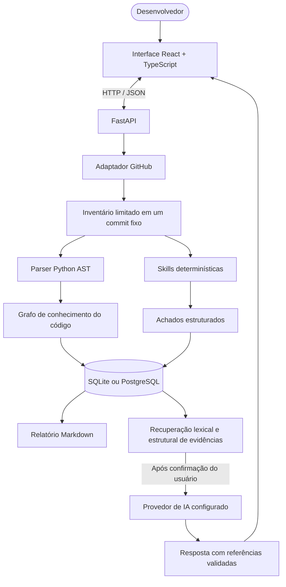

<div align="center">


# Yggdrasil

**Análise estática e mapa de conhecimento de repositórios, com grafo interativo e investigação assistida por IA baseada em evidências.**


[Visão geral](#-visão-geral) · [Funcionalidades](#-funcionalidades) · [Arquitetura](#-arquitetura) · [Instalação](#-começando) · [API](#-api) · [Roadmap](#-roadmap)

<sub>🌐 [English](README.md) · Português (Brasil)</sub>

</div>

---

## 📸 Demonstração

O aplicativo possui uma interface React interativa para explorar análises, nós do grafo, achados e evidências de código. Ainda não foi incluída uma captura de tela ou gravação de uma execução real; o README será atualizado quando uma demonstração capturada do aplicativo em execução estiver disponível.

<!-- TODO: Capturar uma execução real e adicionar em docs/assets/demo.gif.
<p align="center"></p>
-->

## 📖 Visão geral

Entender um código desconhecido exige navegar entre arquivos, definições, imports, testes, configurações e documentação. Um README raramente explica todas as relações, e um achado de análise estática só é útil quando suas evidências podem ser verificadas.

O **Yggdrasil** transforma um repositório público do GitHub em um inventário vinculado a uma versão específica, um grafo navegável, achados estruturados e um relatório Markdown. Ele extrai a estrutura Python suportada sem executar o projeto analisado e permite investigar nós e fazer perguntas fundamentadas em evidências por meio de um provedor de IA opcional.

O projeto foi pensado para desenvolvedores, estudantes, mantenedores e profissionais que fazem uma primeira revisão de código ou segurança de aplicações. É um MVP local em evolução — não uma promessa de compreensão completa nem de ausência de vulnerabilidades.

## ✨ Funcionalidades

- 🌳 **Análise vinculada a um commit** — resolve a referência Git para um SHA, permitindo rastrear os resultados até uma revisão específica.
- 🗂️ **Inventário com limites** — registra arquivos e diretórios encontrados, limites aplicados e motivos para exclusões ou cobertura parcial.
- 🐍 **Parsing estático de Python** — extrai módulos, classes, funções, métodos, imports, indicadores de arquivos de teste e padrões selecionados de endpoints sem importar ou executar o código-alvo.
- 🕸️ **Grafo de conhecimento interativo** — explora arquivos e símbolos com localização de origem e proveniência para relações determinísticas e inferidas.
- 🛡️ **Verificações AppSec iniciais** — identifica padrões que podem indicar segredos expostos, redige padrões reconhecidos antes de persistir conteúdo e cria achados para revisão humana.
- 🧪 **Inventário de arquivos de teste** — reconhece convenções simples de testes Python; não executa testes nem mede cobertura.
- 🔎 **Perguntas fundamentadas em evidências** — opcionalmente recupera definições, testes/exemplos relacionados, documentação relevante e relações do grafo antes de consultar a IA.
- 📍 **Citações verificáveis** — aceita referências apenas quando correspondem às evidências recuperadas; pode retornar uma conclusão inconclusiva quando faltam dados.
- 📡 **Atualizações de análise** — eventos persistidos e Server-Sent Events (SSE) comunicam progresso e permitem retomar a partir de uma posição conhecida.
- 📝 **Relatórios Markdown** — gera relatórios a partir de dados persistidos, não apenas de uma conversa livre.
- 🧭 **Revisão humana de achados** — registra confirmação, falso positivo, risco aceito, não reproduzibilidade ou correção em outra revisão.
- ⚙️ **SQLite por padrão** — começa sem servidor de banco; PostgreSQL também é suportado.

## 🧰 Tecnologias

<p align="center">
  
</p>

| Camada | Tecnologia | Papel |
|---|---|---|
| Interface web | React 19, TypeScript, Vite | Aplicação de página única interativa |
| Canvas do grafo | `@xyflow/react` | Navegação, seleção, zoom e pan do grafo |
| API | Python 3.11+, FastAPI, Pydantic | API HTTP, validação e orquestração da análise |
| Análise estática | `ast` da biblioteca padrão Python | Extrai estrutura Python sem executar o código |
| Persistência | SQLAlchemy, Alembic, SQLite / PostgreSQL | Guarda snapshots, grafo, eventos, achados e exportações |
| Progresso | Server-Sent Events | Envia eventos da análise ao navegador |
| IA (opcional) | Interface configurável compatível com OpenAI, incluindo caminho nativo da API Gemini | Perguntas baseadas em evidências; desativada por padrão |
| Empacotamento | Docker Compose | Stack local opcional com PostgreSQL, API e interface web |

## 🧩 Arquitetura



### Modelo de evidências

O Yggdrasil diferencia **fatos extraídos de forma determinística** de **relações inferidas**. Chamadas inferidas a partir de nomes coincidentes não são apresentadas como comportamento confirmado em execução. As respostas de IA ficam vinculadas às referências recuperadas, mas suas conclusões semânticas ainda exigem revisão humana.

## 🚀 Começando

### Pré-requisitos

- **Python 3.11+** (o script do Windows dá preferência ao Python 3.13 quando disponível).
- **Node.js 22.12+ e npm** para a interface web.
- **Git** para clonar o repositório.
- **Docker Desktop** apenas se optar pelo Docker Compose.

> [!IMPORTANT]
> O MVP não possui autenticação de usuário. Execute-o localmente e mantenha as portas vinculadas a localhost. Não exponha a API ou a interface a uma rede compartilhada ou à internet sem adicionar autenticação, autorização, limites de requisição e uma revisão de segurança.

### Windows — inicialização de desenvolvimento

```powershell
git clone https://github.com/GabrielJalmeida/yggdrasil.git
cd yggdrasil
powershell -NoProfile -ExecutionPolicy Bypass -File ".\scripts\start-dev.ps1"
```

O script cria `.env` a partir de `.env.example` se necessário, cria um ambiente virtual Python, instala as dependências de desenvolvimento da API, aplica as migrations do banco, abre a API em outra janela do PowerShell e inicia o Vite.

Acesse:

- **Interface web:** <http://localhost:5173>
- **Documentação FastAPI / OpenAPI:** <http://127.0.0.1:8000/docs>
- **Verificação de saúde:** <http://127.0.0.1:8000/api/v1/health>

O banco padrão é SQLite local em `services/api/data/yggdrasil.db`. As perguntas por IA permanecem desativadas até a configuração de um provedor.

### Docker Compose

Com o Docker Desktop aberto:

```powershell
docker compose up --build
```

Abra <http://localhost:5173>. O Compose inicia PostgreSQL, API e interface; as portas são vinculadas a `127.0.0.1`. As credenciais do banco no Compose são exclusivas de desenvolvimento e não devem ser reutilizadas em ambientes reais.

### Configuração manual

<details>
<summary><strong>Inicie a API e a interface em terminais separados</strong></summary>

**Terminal 1 — API (na raiz do repositório):**

```powershell
Copy-Item .env.example .env  # somente se .env ainda não existir
cd services/api
py -3.13 -m venv .venv
.\.venv\Scripts\Activate.ps1
python -m pip install --upgrade pip
python -m pip install -e ".[dev]"
python -m alembic upgrade head
python -m uvicorn app.main:app --reload --host 127.0.0.1 --port 8000
```

**Terminal 2 — interface web:**

```powershell
cd apps/web
npm install
npm run dev
```

Há scripts auxiliares para Linux/macOS em `scripts/start-api.sh` e `scripts/start-web.sh`.

</details>

## 🔧 Configuração

Copie `.env.example` para `.env`. A aplicação funciona sem chave de IA; configure um provedor apenas se quiser perguntar sobre um repositório analisado.

<details>
<summary><strong>Variáveis de ambiente</strong></summary>

| Variável | Padrão | Finalidade |
|---|---|---|
| `DATABASE_URL` | `sqlite:///./data/yggdrasil.db` | URL SQLAlchemy; suporta SQLite e PostgreSQL. |
| `GITHUB_TOKEN` | Vazio | Token opcional para reduzir os limites da API do GitHub em repositórios públicos. |
| `FRONTEND_ORIGINS` | `http://localhost:5173,http://127.0.0.1:5173` | Origens autorizadas no CORS da API. |
| `MAX_ARCHIVE_BYTES` | `20971520` | Tamanho máximo do arquivo compactado (20 MiB). |
| `MAX_FILES` | `1000` | Quantidade máxima de entradas/arquivos no inventário. |
| `MAX_TREE_DIRECTORIES` | `2000` | Máximo de consultas a subdiretórios para reconstruir uma árvore Git truncada. |
| `MAX_FILE_BYTES` | `262144` | Tamanho máximo de um arquivo textual (256 KiB). |
| `MAX_TOTAL_TEXT_BYTES` | `8388608` | Orçamento agregado de conteúdo textual (8 MiB). |
| `MAX_TOTAL_UNPACKED_BYTES` | `52428800` | Máximo de dados declarados após descompactação (50 MiB). |
| `AI_PROVIDER` | `disabled` | Defina `openai-compatible` para ativar o adaptador configurado. |
| `AI_API_KEY` | Vazio | Chave do provedor. Obrigatória para serviços hospedados; só pode ser omitida em endpoints locais reconhecidos. |
| `AI_BASE_URL` | `https://api.openai.com/v1` | URL-base do provedor. Para o caminho Google Gemini, use `https://generativelanguage.googleapis.com`. |
| `AI_MODEL` | Vazio | Identificador de modelo disponível para sua conta/provedor. |
| `AI_TIMEOUT_SECONDS` | `90` | Timeout da chamada de IA; o caminho Gemini exige mínimo de 90 segundos. |
| `AI_REASONING_EFFORT` | `low` | Nível de raciocínio enviado ao caminho Google Gemini. |
| `AI_MAX_CONTEXT_CHARS` | `14000` | Limite aproximado de caracteres para o contexto recuperado. |
| `AI_MAX_EVIDENCE_ITEMS` | `8` | Máximo de evidências recuperadas por pergunta. |

</details>

### Habilitar perguntas com IA

Adicione as configurações do provedor ao `.env` e reinicie a API. Exemplo para o caminho da API Google Gemini:

```dotenv
AI_PROVIDER=openai-compatible
AI_API_KEY=sua-chave-local-do-google-ai-studio
AI_BASE_URL=https://generativelanguage.googleapis.com
AI_MODEL=gemini-3.5-flash-lite
AI_TIMEOUT_SECONDS=90
AI_REASONING_EFFORT=low
```

Use um identificador de modelo disponível na sua conta. Nunca versione `.env`, chaves de API ou credenciais reais. O navegador nunca recebe a chave. Antes de enviar uma pergunta, a interface informa que a pergunta e os trechos de evidência selecionados e **redigidos** serão transmitidos ao provedor configurado após confirmação do usuário; o repositório inteiro não é enviado como um único prompt.

## 💡 Fluxo de uso

1. Cole na interface a URL de um repositório público, como `https://github.com/owner/project`, e escolha uma referência Git, por exemplo `main`.
2. Inicie a análise. O Yggdrasil resolve a referência para um commit e mostra cobertura do inventário, símbolos Python suportados, relações do grafo, avisos e achados.
3. Busque ou filtre o grafo; selecione um nó para inspecionar a localização e as evidências textuais redigidas disponíveis.
4. Revise os achados gerados. Trate-os como candidatos até examinar as evidências e o impacto.
5. Com a IA configurada, faça uma pergunta sobre o snapshot analisado e abra as referências citadas.
6. Exporte a análise em Markdown.

## 📡 API

O prefixo da API é `/api/v1`. A documentação OpenAPI interativa fica disponível em <http://127.0.0.1:8000/docs> enquanto a API local estiver em execução.

<details>
<summary><strong>Endpoints disponíveis</strong></summary>

| Método | Endpoint | Finalidade |
|---|---|---|
| `GET` | `/api/v1/health` | Verifica a saúde e a disponibilidade do banco. |
| `GET` | `/api/v1/skills` | Lista as skills habilitadas e suas limitações. |
| `POST` | `/api/v1/analyses` | Inicia uma análise (`202 Accepted`). |
| `GET` | `/api/v1/analyses` | Lista análises recentes. |
| `GET` | `/api/v1/analyses/{analysis_id}` | Consulta estado, commit, contagens, cobertura e avisos. |
| `GET` | `/api/v1/analyses/{analysis_id}/events` | Transmite e reproduz eventos persistidos via SSE. |
| `GET` | `/api/v1/analyses/{analysis_id}/graph` | Consulta nós e arestas com busca e filtros no servidor. |
| `GET` | `/api/v1/analyses/{analysis_id}/nodes/{node_id}` | Carrega detalhes do nó e evidências de origem disponíveis. |
| `GET` | `/api/v1/analyses/{analysis_id}/findings` | Lista achados; aceita filtros de severidade, skill e estado. |
| `PATCH` | `/api/v1/analyses/{analysis_id}/findings/{finding_id}/status` | Registra uma decisão de revisão humana. |
| `POST` | `/api/v1/analyses/{analysis_id}/questions` | Faz uma pergunta fundamentada em evidências sobre uma análise concluída. |
| `GET` | `/api/v1/analyses/{analysis_id}/export/markdown` | Baixa diretamente o relatório. |
| `POST` | `/api/v1/analyses/{analysis_id}/exports/markdown` | Cria uma exportação Markdown persistida. |
| `GET` | `/api/v1/exports/{export_id}` | Baixa uma exportação persistida. |

</details>

## 🧪 Testes e validação

**Última validação registrada para a v0.7.0** (consulte [`docs/PROGRESS.md`](docs/PROGRESS.md)):

- 76 testes do backend passaram com chamadas ao GitHub e ao provedor de IA simuladas.
- O teste de layout do grafo passou com 420 nós sintéticos e sem sobreposições.
- Compilação Python e verificações apenas sintáticas de TypeScript/TSX passaram.
- A instalação completa das dependências, o build do frontend e a execução do ESLint **não foram verificados** naquele ambiente. Uma nova chamada real a um provedor de IA para o fluxo de recuperação v0.7.0 também não fez parte daquela validação.

Execute os testes do backend a partir da raiz do repositório:

```powershell
cd services/api
python -m pip install -e ".[dev]"
python -m pytest -q
```

Execute o teste de layout:

```powershell
cd apps/web
npm install
npm run test:layout
```

O pacote web também disponibiliza `npm run lint` e `npm run build`; execute-os após instalar as dependências.

## 🛡️ Segurança, privacidade e limites

- **Análise somente de leitura:** o código-alvo não é importado, executado, compilado, instalado ou testado pelo Yggdrasil.
- **Restrição de origem GitHub:** URLs são validadas e as requisições usam hosts GitHub fixos; redirecionamentos são recusados.
- **Limites de recursos:** tamanho do arquivo compactado, quantidade e tamanho individual de arquivos, conteúdo agregado e percurso da árvore têm limites configuráveis.
- **Redação de segredos:** padrões de credenciais reconhecidos são redigidos antes de persistir o texto-fonte. A redação por padrões pode não reconhecer segredos desconhecidos ou codificados e não garante anonimização.
- **Conteúdo não confiável:** README, comentários, strings e código do repositório são tratados como dados não confiáveis; o modelo não recebe terminal, sistema de arquivos ou ferramentas de escrita.
- **Privacidade da IA:** com a IA habilitada, a pergunta e trechos redigidos selecionados são enviados ao provedor configurado após confirmação. Não envie código sem autorização para essa transferência.
- **Sem autenticação:** este MVP é local; mantenha os serviços em localhost.
- **Limites da análise estática:** achados exigem revisão humana. Não encontrar um achado não prova que o repositório esteja seguro.

Consulte [`docs/SECURITY.md`](docs/SECURITY.md) para o modelo de ameaça e os riscos residuais.

## 🗂️ Estrutura do repositório

```text
yggdrasil/
├── apps/web/                  # Interface React + TypeScript e canvas do grafo
│   └── scripts/               # Verificações de layout do frontend
├── services/api/
│   ├── app/api/                # Rotas FastAPI
│   ├── app/application/        # Orquestração de análises e perguntas
│   ├── app/domain/             # Grafo, achados, relatórios e padrões de segredo
│   ├── app/infrastructure/     # Adaptador GitHub e provedor de IA
│   ├── alembic/                # Migrations do banco
│   └── tests/                  # Testes de unidade e integração do backend
├── skills/                     # Contratos e manifests versionados das skills
├── docs/                       # Plano, segurança, progresso, ADRs e assets
│   └── assets/                 # Banners locais do README
├── scripts/                    # Auxiliares de desenvolvimento para Windows/Linux
├── .env.example                # Modelo de configuração sem segredos
├── docker-compose.yml          # Stack PostgreSQL local opcional
└── README.md
```

## 🧭 Roadmap

- [x] Ingestão de repositórios públicos GitHub fixada em um commit.
- [x] Parsing estático Python e grafo de conhecimento persistido.
- [x] Skills determinísticas iniciais e achados estruturados com revisão humana.
- [x] Perguntas por IA fundamentadas em evidências, com validação de citações.
- [x] Eventos de progresso e exportação Markdown.
- [x] SQLite como padrão e suporte a PostgreSQL.
- [ ] Validar instalação limpa, build e lint do frontend em CI.
- [ ] Avaliar qualidade da recuperação usando perguntas e citações esperadas.
- [ ] Melhorar a navegação do grafo e paginação de resultados grandes conforme o uso observado.
- [ ] Considerar uma segunda linguagem e recuperação semântica somente se a avaliação demonstrar benefício.
- [ ] Explorar comparação de snapshots e reanálise incremental.

Consulte o [Plano Mestre de Engenharia](docs/MASTER-PLAN.md) para a direção do produto e [`docs/PROGRESS.md`](docs/PROGRESS.md) para o estado verificado da implementação e as limitações restantes.

## 🤝 Contribuindo

Issues e pull requests focados são bem-vindos. Antes de propor funcionalidades, leia os limites atuais e o modelo de segurança. Prefira mudanças pequenas, testáveis e que preservem a análise somente de leitura de repositórios de terceiros.

1. Faça um fork e crie uma branch a partir de `main`.
2. Implemente uma mudança focada e adicione ou atualize testes.
3. Execute as verificações relevantes do backend ou frontend.
4. Descreva o comportamento, as evidências de teste e as limitações restantes no pull request.

## 📜 Licença

O Yggdrasil é distribuído sob a [licença MIT](LICENSE).

## 👤 Autor

Criado por **[GabrielJalmeida](https://github.com/GabrielJalmeida)**.

---

<div align="center">

**Mapa antes do palpite. Evidência antes da conclusão.**

Se o Yggdrasil for útil para você, considere deixar uma ⭐ no repositório.

</div>

<div align="center">
  
</div>
